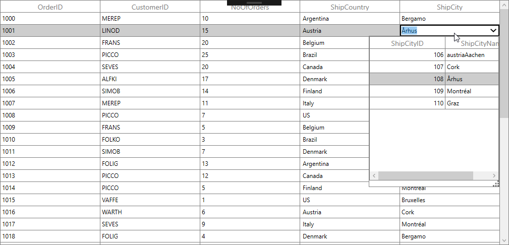
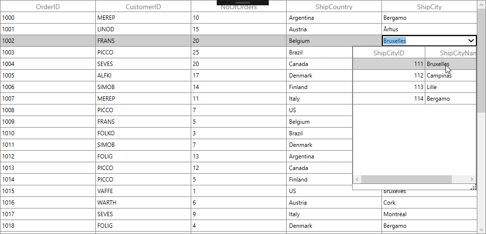
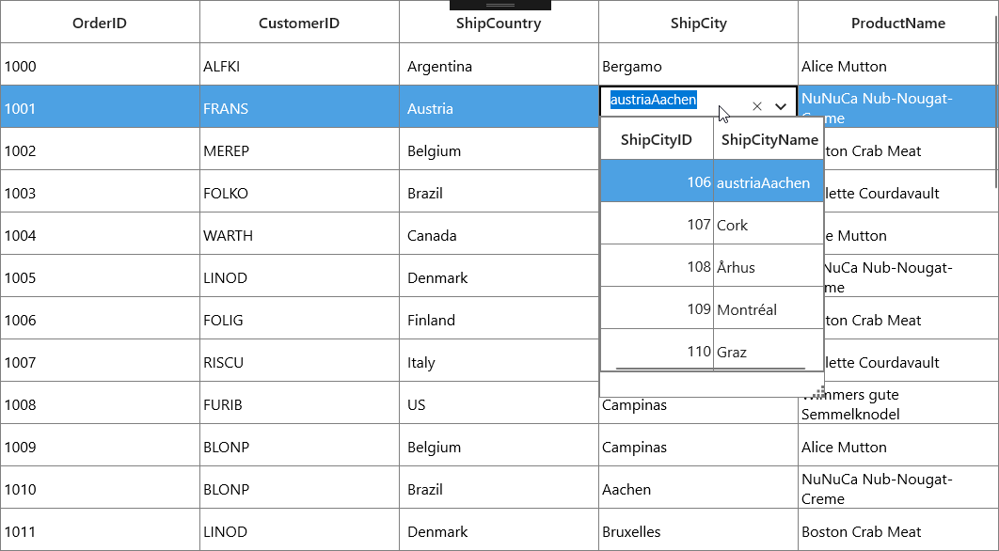
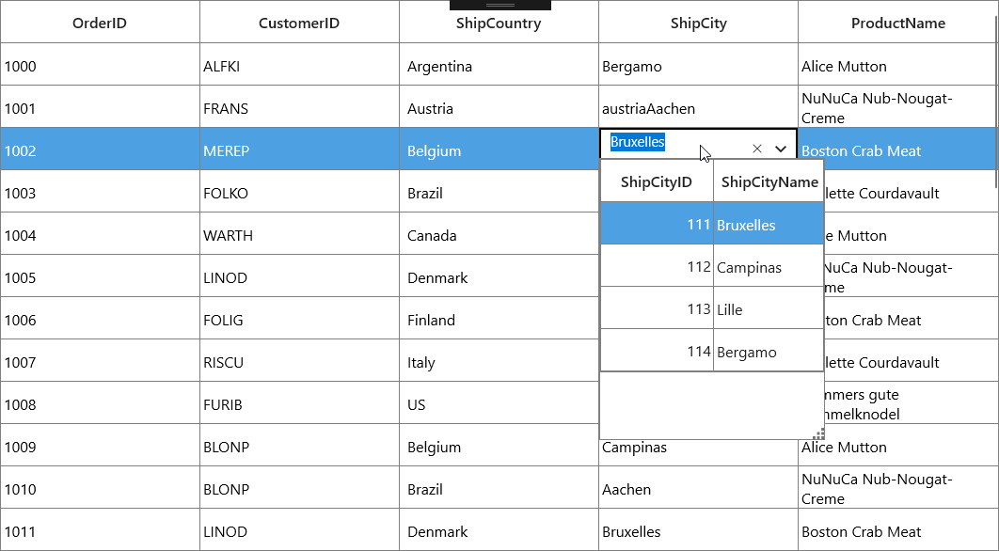

# How to Load Different Items for Each Row in Multicolumn Dropdown Column in WPF / UWP DataGrid?

This example illustrates how to load different items for each row in multicolumn dropdown column in [WPF DataGrid](https://www.syncfusion.com/wpf-controls/datagrid) and [UWP DataGrid](https://www.syncfusion.com/uwp-ui-controls/datagrid) (SfDataGrid).

You can load different ItemsSource to each row of **GridMultiColumnDropDownList** by setting the **SfDataGrid.ItemsSourceSelector** property.

### Implementing IItemsSourceSelector

**ItemsSourceSelector** needs to implement the **IItemsSourceSelector** interface, which is required to implement the **GetItemsSource** method. The **GetItemsSource** method receives the following parameters:

<li> <b>Record</b> – Data object associated with row.</li>
<li> <b>Data Context</b>  – Data context of data grid.</li>

In the following code, ItemsSource for **ShipCity** column is returned based on **ShipCountry** column value using the record and data context of data grid passed to the **GetItemsSource** method.

## For WPF:

#### XAML

``` xml
<Window.Resources>
        <local:ItemsSourceSelector x:Key="itemSourceSelector" />
</Window.Resources>
<syncfusion:SfDataGrid x:Name="sfdatagrid"
                       AllowEditing="True"
                       AutoGenerateColumns="False"
                       AllowFiltering="False"
                       ItemsSource="{Binding OrderDetails}"
                       ColumnSizer="Star">            
    <syncfusion:SfDataGrid.Columns>
        <syncfusion:GridTextColumn MappingName="OrderID" />
        <syncfusion:GridTextColumn MappingName="CustomerID" />
        <syncfusion:GridTextColumn MappingName="NoOfOrders" />
        <syncfusion:GridComboBoxColumn MappingName="ShipCountry" ItemsSource="{Binding Path=DataContext.CountryList, ElementName=sfdatagrid}"/>
        <syncfusion:GridMultiColumnDropDownList AllowEditing="True"	
                                                HeaderText="ShipCity" DisplayMember="ShipCityName"
                                                ItemsSourceSelector="{StaticResource itemSourceSelector}"
                                                MappingName="ShipCityID" ValueMember="ShipCityID"/>
    </syncfusion:SfDataGrid.Columns>
 </syncfusion:SfDataGrid>
```

#### C#

``` c#
/// <summary>
/// Implementation class for ItemsSourceSelector interface
/// </summary>
public class ItemsSourceSelector : IItemsSourceSelector
{
    public IEnumerable GetItemsSource(object record, object dataContext)
    {
        if (record == null)
            return null;
  
        var orderinfo = record as OrderDetails;
        var countryName = orderinfo.ShipCountry;
        var viewModel = dataContext as ViewModel;
        //Returns ShipCity collection based on ShipCountry.
        if (viewModel.ShipCities.ContainsKey(countryName))
        {
            ObservableCollection<ShipCityDetails> shipCities = null;
            viewModel.ShipCities.TryGetValue(countryName, out shipCities);
            return shipCities.ToList();
        }
        return null;
    }
}
```
The following screenshot illustrates different **ShipCity** ItemsSource bound to each row of the **MultiColumnDropDownList** based on country name.





## For UWP:

#### XAML

``` xml
<Page.Resources>
        <local:ItemsSourceSelector x:Key="itemSourceSelector" />
</Page.Resources>

<syncfusion:SfDataGrid x:Name="sfdatagrid"
                       AllowEditing="True"
                       AutoGenerateColumns="False"
                       ItemsSource="{Binding OrderDetails}"
                       ColumnSizer="Star">
   <syncfusion:SfDataGrid.Columns>
                <syncfusion:GridTextColumn MappingName="OrderID" />
                <syncfusion:GridTextColumn MappingName="CustomerID" />
                <syncfusion:GridComboBoxColumn MappingName="ShipCountry"  ItemsSource="{Binding Path=DataContext.CountryList, ElementName=sfdatagrid}"/>
                <syncfusion:GridMultiColumnDropDownList AllowEditing="True"  HeaderText="ShipCity"  DisplayMember="ShipCityName"
                                         				ItemsSourceSelector="{StaticResource itemSourceSelector}" 
														MappingName="ShipCityID"  ValueMember="ShipCityID"/>
                <syncfusion:GridTextColumn MappingName="ProductName" />
           </syncfusion:SfDataGrid.Columns>
 </syncfusion:SfDataGrid>
```

#### C#

``` csharp
/// <summary>
/// Implementation class for ItemsSourceSelector interface
/// </summary>
public class ItemsSourceSelector : IItemsSourceSelector
{
    public IEnumerable GetItemsSource(object record, object dataContext)
    {
        if (record == null)
            return null;
  
        var orderinfo = record as OrderDetails;
        var countryName = orderinfo.ShipCountry;
        var viewModel = dataContext as ViewModel;
  
        //Returns ShipCity collection based on ShipCountry.
        if (viewModel.ShipCities.ContainsKey(countryName))
        {
            ObservableCollection<ShipCityDetails> shipCities = null;
            viewModel.ShipCities.TryGetValue(countryName, out shipCities);
            return shipCities.ToList();
        }
        return null;
    }
}
```

The following screenshot illustrates the different **ShipCity** ItemsSource bound to each row of **MultiColumnDropDownList** based on the country name.



